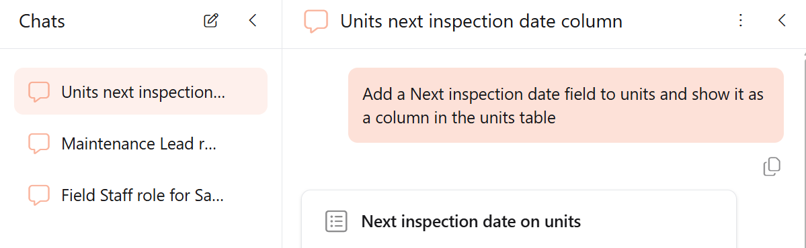

# Gainable docs — notes for Claude

Mintlify site for Gainable, published at https://docs.gainable.dev. This repo is public.
Pages are `.mdx`; navigation, redirects and theme live in `docs.json`. Merging to `main` deploys to production, and every pull request gets a Mintlify preview link as a bot comment.

Most sessions here fix one docs issue at a time, started with `/docfix`. The human side of that workflow, including setup, is in `CONTRIBUTING.md`.

This file lives in `.claude/` on purpose. Mintlify turns markdown files in the repo into pages, and a root `CLAUDE.md` showed up at docs.gainable.dev/CLAUDE. It skips folders that start with a dot, plus `README.md` and `CONTRIBUTING.md`. Notes that aren't docs pages belong in `.claude/` or `.github/`.

## Ground rules

- Work on a branch (`docs/<short-slug>`) and open a PR. Don't commit to `main` unless the user explicitly asks. One fix per branch, one branch per PR.
- Don't write a UI label, button name, menu path, URL, parameter or limit you haven't seen in the product. Check it in the browser (Claude in Chrome; the user is signed in to https://build.gainable.dev) or ask the user to check. If it can't be verified, say so instead of guessing.
- If the product doesn't behave the way the docs say, stop and ask whether the docs or the product are wrong. Never rewrite the docs to describe a bug as normal behavior.
- Describe the product as it is, as if it had always worked this way. Never mention earlier behavior, retired features or renames on a page or in the Fin CSV. That means no "replaces", "used to", "previously", "no longer", "new" or "now supports", and no changelog page. Redirects are fine, because readers don't see them.
- Make the smallest complete change. Keep the page's structure, tone and components. Fix the same instruction everywhere it appears: search every `.mdx` file for the label or phrase before you finish.
- Commit messages follow `docs(<area>): <what changed>`, e.g. `docs(prompting): correct the Undo button label`.

## Pages and navigation

- Frontmatter is `title` and `description`, both quoted.
- A new page must be added to `navigation` in `docs.json`, and to the tree in `README.md`.
- Renaming or moving a page needs an entry in `redirects` in `docs.json` so old links keep working.
- Components already in use: `Steps`/`Step`, `Card`/`CardGroup`, `Accordion`/`AccordionGroup`, `Tabs`/`Tab`, `CodeGroup`, `Note`, `Tip`, `Info`, `Warning`, `Frame`. Prefer these over introducing new ones.
- Current names. The rule is **"Gaia builds, the Assistant works in your app."**
  - **Gaia** is Gainable's AI. It builds and changes apps, in the builder or through the MCP connector.
  - Every app has its own **Assistant**. Owners can rename it, but the docs always say "the Assistant" and may note once that it can have another name.
  - Never use these names on a page: **Gaia Copilot**, **Gaia Autopilot**, Ask AI, Cowork (meaning Gainable's coworker; Anthropic's Claude Cowork is fine). The `copilots/*` and `autopilot/*` pages are being removed.
  - Data lives in **datasets** (not "data connectors"). **The MCP connector** replaced the retired CLI (`/cli/*` redirects to `/mcp/*`).
  - "Building your own data connector" means your AI tool (Claude Code and others) reads a source and pushes it into a dataset with `dataset_sync`. It is not a Gainable feature.
  - **Data manager** is a per-user permission next to Administrator, not a role. Roles and groups decide what people see, never what they administer.
- The site has four tabs, one per reader. Put a page in the tab its reader works in:
  - **Build**: building apps and working with datasets.
  - **Own**: app owners and admins (access, the app's data, setting up the Assistant). New pages go in `own/`.
  - **Use**: everyone in an app (Apps grid, notifications, messaging, the Assistant, mobile). New pages go in `use/`.
  - **Develop**: the MCP connector, plugins and code.
  - The full restructure plan is in `.claude/plans/docs-restructure-2026-11.md`.
- `fin-ai-training-questions.csv` is the Q&A set that trains the Intercom Fin support bot. If a fix changes a fact, search the CSV for it and update the answer too.

## Screenshots

- Files go in `images/` as PNG, kebab-case, named for what they show (`chats-panel.png`, not `screenshot-3.png`).
- Embed them the way the rest of the site does:

  ```mdx
  <Frame>
    
  </Frame>
  ```

  Alt text describes what the image shows as a full phrase. Never just "screenshot".
- Capture from the docs demo account (the "Docs" organization) that is signed in to Chrome, never from a real account. You can create and change anything in it. Its app sign-in links carry a `key=` parameter, so never put one in a page or a commit.
- Light mode, demo data only. No real customer names, emails, API keys or tokens in frame. Crop to the part of the UI the text is about, with no browser tab bar or address bar.
- To capture with Claude in Chrome, take a `screenshot` to locate the region, then capture it with the `zoom` action and `save_to_disk: true`, which saves a full-resolution PNG. Don't publish a saved full-page `screenshot`: it's a downscaled JPEG and looks soft on the site. Copy the PNG into `images/`, then open it (Read) and confirm it shows what the text says before you reference it.
- When the user captured it themselves, Windows Snipping Tool saves to `%USERPROFILE%\Pictures\Screenshots`. "Use my last screenshot" means the newest file there.
- Before replacing an outdated screenshot, search for its filename. If every page that uses it should show the new version, overwrite it under the same name; otherwise add a new file. Delete images that nothing references anymore.
- Annotations (red boxes, arrows) are added by the user in Snipping Tool. Don't try to draw them.

## Checks before a PR

Both pass on `main`, so a failure means the current change caused it:

- `mint broken-links`
- `mint validate`

Then have the user look at the page in `mint dev` (http://localhost:3000) and, once the PR is open, in the Mintlify preview linked from the PR.
