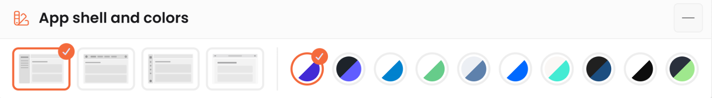
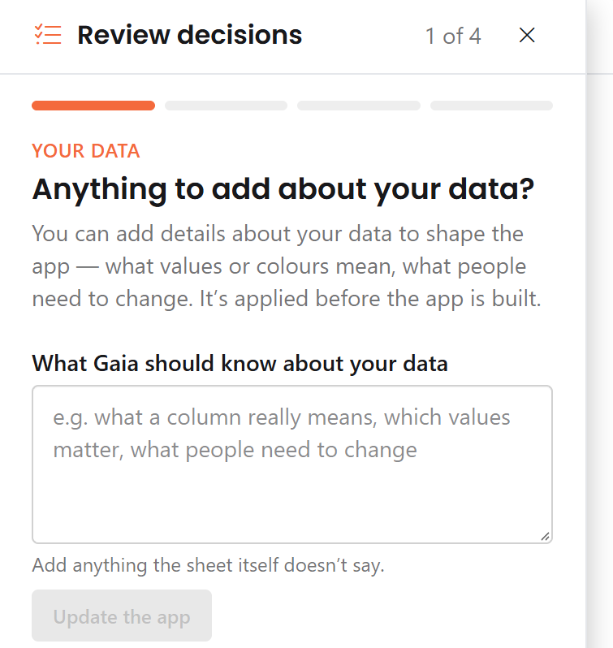
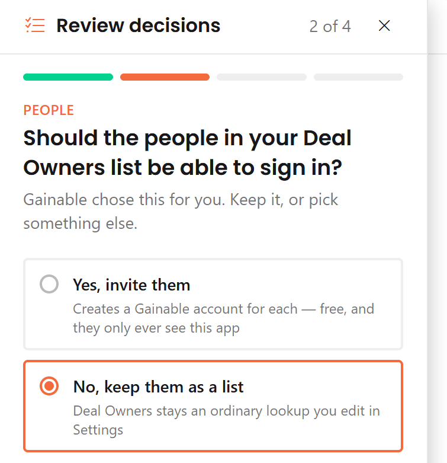
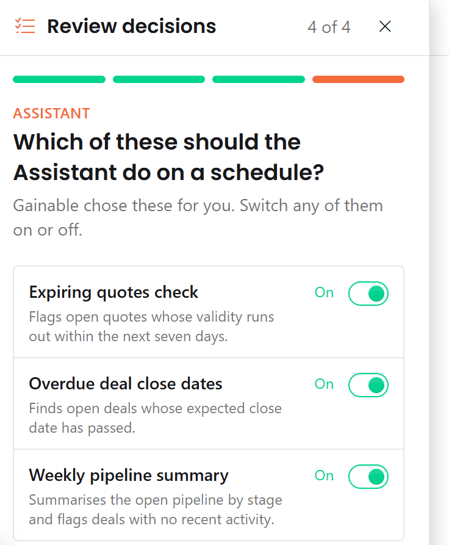

Your data is the best description of your app. Drop in the spreadsheets your team works from, or connect the tools you already use, and Gaia works out what the data is, how the pieces connect, and what app and workflow would help. You review its decisions and press Build.

## Where your data can come from

| Source | How |
|--------|-----|
| **Excel or CSV files** | Upload one or several at once. Each file can have several sheets. |
| **Google Sheets** and **Excel Online** | Connect your account and pick the spreadsheets. They stay connected, so the app can sync from them later. |
| **Connected apps** such as HubSpot, Airtable, Stripe or Supabase | Add a data connection, then put it in a [dataset](/build/datasets). |
| **Anything else** | Have your AI tool collect it into a dataset. See [Bring any source](/mcp/datasets). |

You can start from [gainable.dev](https://www.gainable.dev) by dropping sheets into the box, or from [build.gainable.dev](https://build.gainable.dev) by choosing **Build from data** and picking a dataset, or **New dataset** to create one.

## Several sheets, one app

You don't have to merge your sheets first. Drop in everything that belongs to the same work (customers, orders, invoices, the notes sheet someone keeps on the side) and Gaia reads them together:

- It recognizes the same kind of record across files and links them. A deals sheet that names a company by its name or email gets a real link to that company.
- Two files that hold the same things under different ids become one table.
- A kind of record you have no rows for yet still gets its own table, ready to fill.

See [How Gaia reads your spreadsheets](/build/spreadsheets) for how it handles currencies, color-coded cells, hidden columns and text dates.

## Watch it take shape

After you start, the left side of the builder shows two stages:

**Importing your data**: reading your data, understanding it, designing the data model, importing your rows, and connecting it to your app.

**Designing your app**: data models, calculations, the interface (pages and navigation), lists used in dropdowns and labels, and the Assistant with its scheduled work.

The preview on the right fills in as the design progresses, first with placeholders and then with your real data. Use **App shell and colors** under the preview to choose a layout (top navigation, classic sidebar, mini rail or workspace) and a color theme. What you pick carries into the finished app.

<Frame>
  
</Frame>

## Review decisions

When the design is done, you have two choices:

- **Build with recommendations** builds the app as Gaia designed it.
- **Review decisions** walks you through the choices Gaia made, one at a time. Change any of them, and the preview updates as you go.

The decisions depend on your data. Typically:

<AccordionGroup>
  <Accordion title="Your data: anything to add?">
    Tell Gaia what the sheets don't say: what a column really means, which values matter, what colors stand for, what people need to change. Select **Update the app** and it's applied before the app is built.

    <Frame>
      
    </Frame>
  </Accordion>
  <Accordion title="People: should they be able to sign in?">
    When a sheet lists people, such as deal owners, Gaia asks whether they should become users of the app. **Yes, invite them** gives each one a free account that only sees this app. **No, keep them as a list** keeps them as an ordinary list you edit in Settings. Nobody is invited unless you choose it.

    <Frame>
      
    </Frame>
  </Accordion>
  <Accordion title="Pages: which view is the home page?">
    Pick the page people land on. Gaia marks the one it recommends.
  </Accordion>
  <Accordion title="Assistant: what should it do on a schedule?">
    Gaia suggests recurring jobs for the app's Assistant, such as an overdue check or a weekly summary. Switch each one on or off. You can change them later. See [Scheduled tasks](/own/assistant#scheduled-tasks).

    <Frame>
      
    </Frame>
  </Accordion>
</AccordionGroup>

When you're done, select **Keep and close**, then **Build the app**.

## Build and go

Building takes a few minutes. The builder shows each step, and when it's done, **Your app is ready**. Select **Go to app** to open it in the builder, where you can change it by chatting with Gaia, publish it, and invite your team.

If you started without an account, you sign up when you select **Build the app**. Your design is kept and the build starts by itself.

## Start from an idea instead

No data yet? On [build.gainable.dev](https://build.gainable.dev), choose **Describe your app** and describe what you need. Gaia creates the data models for you, and you can add data sources later. See the [Prompt guide](/prompting/overview) for how to describe an app well.

## Next steps

<CardGroup cols={2}>
  <Card title="Datasets" icon="layer-group" href="/build/datasets">
    Connect sources and keep your data in sync
  </Card>
  <Card title="How Gaia reads your spreadsheets" icon="table" href="/build/spreadsheets">
    Currencies, colors, hidden columns and dates
  </Card>
  <Card title="Changing a built app" icon="pen" href="/prompting/refining">
    Ask for changes once your app is running
  </Card>
  <Card title="Own an app" icon="shield-halved" href="/own/overview">
    Decide who gets in and what they see
  </Card>
</CardGroup>
