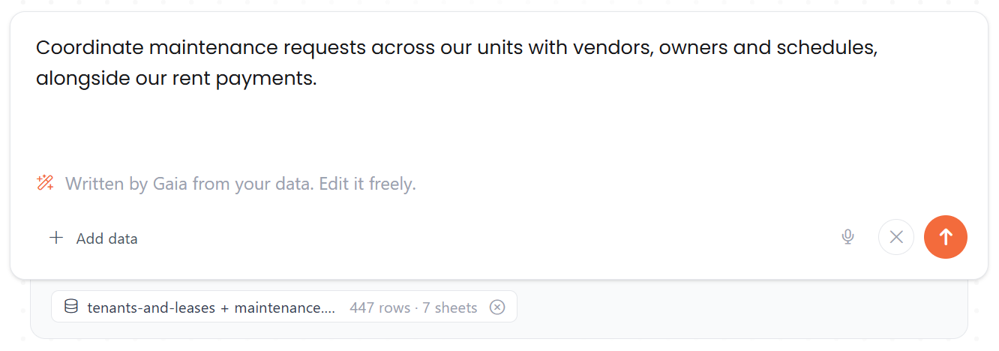
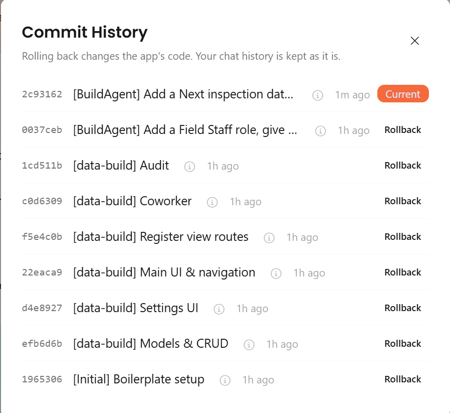

## One prompt to start

Every app starts in the same place: the prompt on [build.gainable.dev](https://build.gainable.dev). Describe the app, add the data to build it from, or both.

<Frame>
  
</Frame>

- **Add data** brings in what the app is built from: one of **Your datasets**, an **Excel or CSV file**, **Google Sheets** or **Excel Online**. You can add several, and Gaia reads them together.
- **Gaia writes the prompt from your data.** Once it has read the data, it writes a line describing the app the data points to. Edit it freely, or replace it with your own words.
- **Gaia suggests what's missing.** When you write the prompt yourself, Gaia suggests anything your data holds that the prompt leaves out, or, without data, what the app should track. Select **Add** to take the suggestion.
- **A brief** is a PDF or Markdown file, such as a spec or a process description. Gaia reads it as background for the design, not as data. Add one from the same **Add data** menu.

Then send it. From there, every app goes the same way:

<Steps>
  <Step title="Gaia designs the app">
    If you uploaded files, Gaia imports them first. Then it designs the data models, calculations, pages, lists, and the Assistant's scheduled work. The preview fills in as it goes, and you can pick a layout and colors under **App shell and colors**.
  </Step>
  <Step title="You review its decisions">
    Select **Build with recommendations**, or walk through **Review decisions** to change the home page, who can sign in, and what the Assistant does on a schedule.
  </Step>
  <Step title="Build and validation">
    The Build Agent generates the app from the design, and validation checks catch common issues before delivery.
  </Step>
  <Step title="Your app is ready">
    A working app, filled with your data if you added any, with its Assistant ready to answer questions.
  </Step>
</Steps>

See [Build from data](/build-from-data) for the whole walkthrough, and [Where you build](/build-from-data#where-you-build) to do the same from Claude, ChatGPT or Claude Code.

## What makes this different?

Gainable creates **complete, production-ready applications**, not code snippets:

| Traditional AI Code | Gainable |
|---------------------|----------|
| Generates code snippets | Generates complete apps |
| You assemble the pieces | Everything is connected |
| Basic text completion | Specialized agents with deep expertise |
| Generic output | Follows proven patterns |

## The agent system

Gainable uses multiple build agents, each specialized for a specific task:

<CardGroup cols={2}>
  <Card title="Planner Agent" icon="clipboard-list">
    Analyzes your request and creates a detailed build plan. Identifies data models, views, and features needed.
  </Card>
  <Card title="Build Agent" icon="hammer">
    Generates the code for your application. Creates database models, routes, and user interfaces.
  </Card>
  <Card title="DataAnalyzer Agent" icon="magnifying-glass-chart">
    Examines the data you add: its schemas and sample rows. Identifies the domain, recommends features, and produces the design you review before building.
  </Card>
  <Card title="Validation Agent" icon="shield-check">
    Checks generated code for common issues and ensures it follows best practices.
  </Card>
  <Card title="Conversation Agent" icon="comments">
    Answers questions about your project and helps you understand what was built.
  </Card>
</CardGroup>

## Beyond building: the Assistant inside your apps

The agents above (Planner, Build, Validation, Conversation) work behind the scenes to *build* your app. Once it's live, its **Assistant** works inside it. It answers from the app's live data, updates records, writes documents, and runs scheduled tasks, always with the access of the person asking.

<CardGroup cols={2}>
  <Card title="Set up the Assistant" icon="sliders" href="/manage/assistant">
    Shape your app's Assistant, its scheduled tasks and its tools
  </Card>
  <Card title="Work with the Assistant" icon="comments" href="/use/assistant">
    Ask questions, update records and write documents with the Assistant
  </Card>
</CardGroup>

## What happens when you send a prompt

Let's follow a real example through the system:

<Accordion title="Example: 'Build a task tracker with due dates and priorities'">
**1. Planner Agent receives your request**

The Planner identifies:
- You need a Task data model
- Fields: title, description, due date, priority
- You'll need a view to manage tasks
- CRUD operations (create, read, update, delete)

**2. Plan is created**

```
Summary: Build task tracker with due dates and priority levels

Features:
- Task management (add, edit, delete tasks)
- Due date tracking
- Priority levels (low, medium, high)
- Task list view

Data model:
- Task: title, description, dueDate, priority, completed
```

**3. Build Agent generates code**

The Build Agent creates:
- Database model for Task
- API routes for CRUD operations
- A task list view with forms
- Priority badges and date formatting

**4. Validation runs**

Checks ensure:
- All fields are properly connected
- Forms save data correctly
- The interface works on mobile

**5. Your app is ready**

You now have a working task tracker you can use immediately.
</Accordion>

<Accordion title="Example: Building from a Google Sheet of sales deals">
**1. You connect your Google Sheet**

The sheet has columns: Deal Name, Company, Amount, Stage (New, Qualified, Proposal, Won, Lost), Close Date, Owner.

**2. Gaia reads the sheet and designs the app**

The agent identifies:
- Domain: CRM / Sales (deal + amount + stage enum)
- Pipeline enum: Stage with 5 values → kanban board
- Currency field: Amount → KPI cards and charts
- Date field: Close Date → timeline filtering

**3. You review its decisions**

Gaia recommends the pipeline overview as the home page, keeps the owners as a list, and suggests an overdue-deal check for the Assistant. You open **Review decisions**, make the Owner column into app users, and keep the rest.

**4. You choose a layout and colors**

You pick the classic sidebar layout and a theme under **App shell and colors**, then select **Build the app**.

**5. Build Agent generates the app**

The Build Agent creates:
- A kanban board with deals grouped by stage
- A dashboard with pipeline value KPIs and charts by stage
- A searchable deal table
- Comments on individual deals
- An Assistant that knows the deals data

**6. Your app is ready**

Pre-populated with all your Google Sheet data, ready to use immediately.
</Accordion>

## How iteration works

Gainable remembers everything about your project. When you ask for changes:

1. **Context is preserved** - The AI knows what's already built
2. **Existing features are protected** - New additions don't break what works
3. **Changes are targeted** - Only the relevant parts are modified
4. **Every change is versioned** - Each successful build creates a snapshot you can revert to

<Tip>
This means you can build incrementally and experiment freely. Start with something simple, add features one at a time, and roll back anything that doesn't work out.

For how to phrase those requests, see [Changing a built app](/prompting/refining).
</Tip>

### Commit history

Every build creates a commit with a description of what changed. To go back to any earlier version:

1. In the builder, click the **three-dot menu** (⋮) at the top of the chat panel
2. Select **Commit history**
3. Select **Rollback** on the version you want

<Frame>
  
</Frame>

Rolling back changes the app's code. Your chat history is kept as it is. Access rules created after the version you return to are set aside, and the result says which it kept.

<Accordion title="How rollback safety works">
When you rollback, Gainable automatically creates a safety snapshot of your current state before reverting. This means you can **undo a rollback** if you change your mind — just open Commit history again and click **Undo** to restore the state before the rollback.
</Accordion>

## Technical foundation

Every Gainable app is built on a proven tech stack:

| Layer | Technology | What it does |
|-------|------------|--------------|
| **Database** | MongoDB | Stores all your data flexibly |
| **Backend** | Node.js + Express | Handles data operations |
| **Frontend** | Modern HTML/CSS/JS | Responsive interface that works on any device |
| **Real-time** | Socket.IO | Instant updates across users |
| **UI Components** | DaisyUI + Tailwind | Polished, themeable design |
| **Collaboration** | Weavy | Chat, files, and comments |

<Note>
You don't need to know any of these technologies to use Gainable. This is just what powers your apps behind the scenes.
</Note>

## Learn more

<CardGroup cols={2}>
  <Card title="Meet the build agents" icon="users" href="/concepts/agents">
    Deep dive into the agents that build your app
  </Card>
  <Card title="Build from data" icon="database" href="/build-from-data">
    Connect external data sources and let Gainable design your app
  </Card>
  <Card title="Explore skills" icon="wand-magic-sparkles" href="/concepts/skills">
    Discover built-in features you can request
  </Card>
  <Card title="Set up the Assistant" icon="sliders" href="/manage/assistant">
    Shape your app's Assistant, its scheduled tasks and its tools
  </Card>
  <Card title="Work with the Assistant" icon="comments" href="/use/assistant">
    Ask questions, update records and write documents with the Assistant
  </Card>
</CardGroup>
