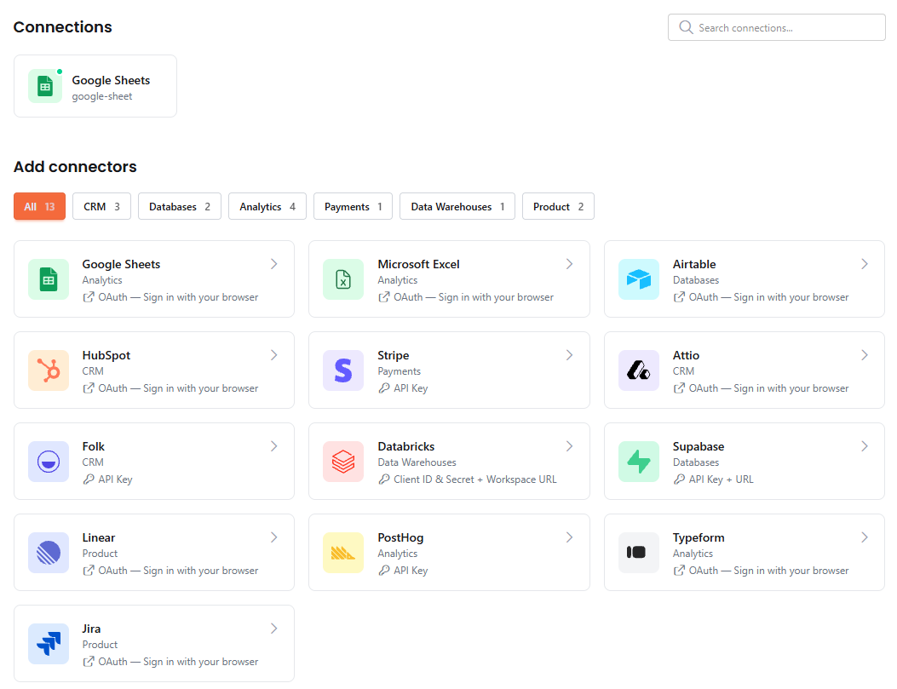

A **data connection** is your signed-in account for a tool such as HubSpot or Stripe. Once it's connected, you add it to a [dataset](/data/datasets), and Gaia reads its data from there.

In the builder, open your account menu and select **Data**, then **Data connections**. Your connections are listed at the top, and **Add connectors** below lists every tool you can connect.

<Frame>
  
</Frame>

## Connectors

| Connector | Category | How it signs in |
|-----------|----------|-----------------|
| Google Sheets | Analytics | Sign in with your browser (OAuth) |
| Microsoft Excel | Analytics | Sign in with your browser (OAuth) |
| Airtable | Databases | Sign in with your browser (OAuth) |
| Supabase | Databases | API key and URL |
| HubSpot | CRM | Sign in with your browser (OAuth) |
| Attio | CRM | Sign in with your browser (OAuth) |
| Folk | CRM | API key |
| Stripe | Payments | API key |
| Databricks | Data Warehouses | Client ID and secret, plus workspace URL |
| PostHog | Analytics | API key |
| Typeform | Analytics | Sign in with your browser (OAuth) |
| Linear | Product | Sign in with your browser (OAuth) |
| Jira | Product | Sign in with your browser (OAuth) |

For a source that isn't on the list, let your AI tool be the connector. See [Bring any source](/data/any-source).

## Add a connection

<Steps>
  <Step title="Pick the connector">
    Under **Add connectors**, select the tool. The category buttons above the list narrow it down.
  </Step>
  <Step title="Name it">
    Give the connection a **Connection Name** you'll recognize later, such as "Marketing HubSpot". It's useful when you connect more than one account of the same tool.
  </Step>
  <Step title="Sign in or enter the key">
    For a browser sign-in, select **Connect** and sign in to the tool. For a key, paste it and select **Save Connection**. Each key dialog has a **How to get your API key** link to the tool's own instructions. For Stripe, use a restricted key in production.
  </Step>
</Steps>

The connection then shows under **Connections**.

## Use it in a dataset

A connection doesn't bring any data in on its own. Add it to a dataset: create one and choose the connection when **Create Dataset** asks which connections to include. Gaia analyzes it together with the dataset's other sources and links records across them, so a spreadsheet row can link to a HubSpot contact by name or email. See [Create a dataset](/data/datasets#create-a-dataset).

Google Sheets and Excel Online can also be added straight from **Add data** under the prompt when you build.

## Manage a connection

Select a connection under **Connections** to see its provider, when it was connected and its status. From there you can:

- **Rename** it: edit **Connection Name** and select **Save**.
- **Test Connection** to check that the sign-in or key still works.
- **Delete** it.
