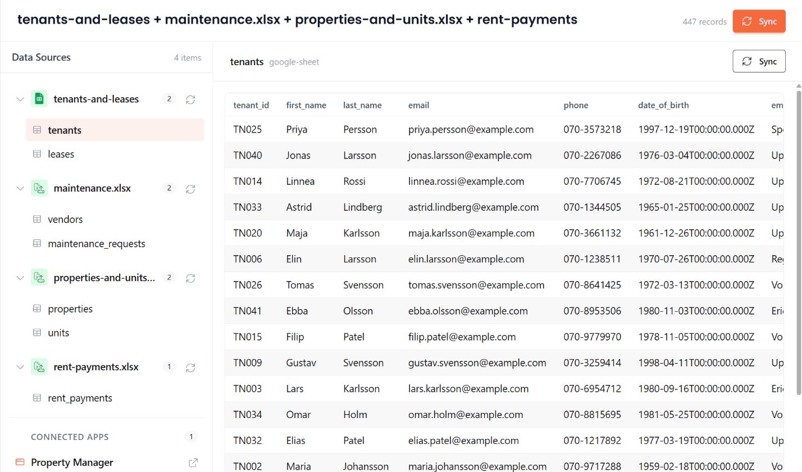
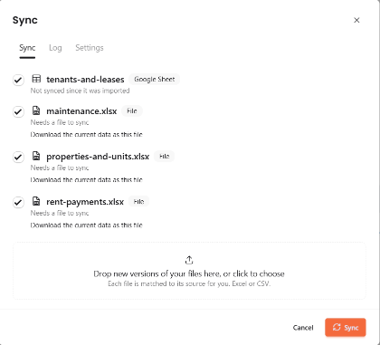
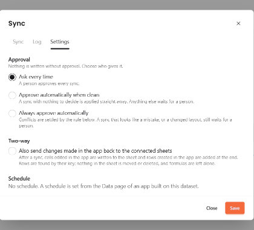

A **dataset** is the data an app is built on. It holds one or more **sources** (uploaded files, Google Sheets, Excel Online workbooks or connected tools such as HubSpot) and the tables Gaia made from them. One dataset can feed several apps.

When you build from spreadsheets, Gaia creates the dataset for you. You can also create one yourself and build from it later.

## Your datasets

In the builder, open your account menu and select **Data**, then **Datasets**. Select a dataset to see:

- **Data Sources**: each file, sheet or tool in the dataset and the tables it fills. Select a table to preview its rows.
- **Connected apps**: the apps built on this dataset.
- **Sync**: bring the dataset up to date. See [Keep data in sync](#keep-data-in-sync).

<Frame>
  
</Frame>

## Connect a tool

To use data from a tool such as HubSpot, Stripe or Airtable, connect it under **Data → Data connections** first, then add the connection to a dataset. See [Data connections](/data/connections).

For a source that isn't on the list, let your AI tool be the connector: it reads the source and sends the rows to a dataset. See [Bring any source](/data/any-source).

## Create a dataset

On [build.gainable.dev](https://build.gainable.dev), select **Add data** under the prompt, then **Your datasets** → **New**. That opens your datasets: select **+** next to **Datasets** and follow **Create Dataset**: give it a name, then choose which connections to include or upload files. To build from it, add it to the prompt from **Add data** → **Your datasets**.

When several sources go into one dataset, Gaia analyzes them together into one data model and links records across them. A spreadsheet can link to a connected tool's records by name or email, too.

## Keep data in sync

Select **Sync** on a dataset to bring it up to date from its sources.

<Frame>
  
</Frame>

- **Connected sheets and tools** are read again directly.
- **Uploaded files** need a new version. Drop the new files in the dialog and each one is matched to its source. **Download the current data as this file** gives you the app's current data in the file's own layout, so you can edit it and upload it again.

A sync merges. It doesn't replace your data. Rows are matched on a key column, so edits people made in the app and rows they created there are kept. Unchanged rows aren't rewritten. If a file's layout has changed, such as a renamed tab or renamed columns, Gaia matches it again and asks you to confirm. Anything it can't settle on its own is handed to a conversation with the app's Assistant.

The **Log** tab lists past syncs, and a sync can be undone from there.

### Approval and two-way sync

The **Settings** tab in the Sync dialog sets how syncs are applied:

<Frame>
  
</Frame>

| Setting | Options |
|---------|---------|
| **Approval** | **Ask every time**: a person approves every sync. **Approve automatically when clean**: a sync with nothing to decide is applied straight away, and anything else waits for a person. **Always approve automatically**: conflicts are settled by rule, but a sync that looks like a mistake, or a changed layout, still waits for a person. |
| **Two-way** | **Also send changes made in the app back to the connected sheets.** After a sync, cells edited in the app are written to the Google Sheet or Excel Online workbook, and rows created in the app are added at the end. Rows are found by their key, nothing in the sheet is moved or deleted, and formulas are left alone. |
| **Schedule** | Set from the **Data** page of an app built on the dataset. See [Keep the app's data current](/manage/data). |

The people who can run and approve syncs for an app are its administrators and its [Data managers](/manage/access#people-in-the-app).

## A source gained a column

When a source gains a column, a sync can add it to the dataset, and from there you can add it to the app.
