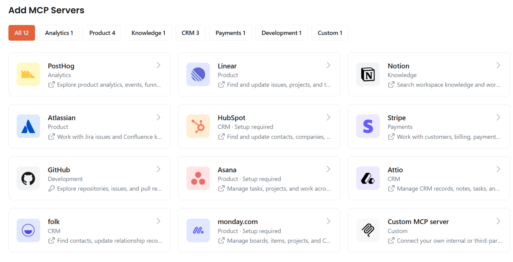

An app's [Assistant](/manage/assistant) works with the app's data. With an **MCP server**, it can also use tools outside Gainable: find a Linear issue, read a Notion page, look up a Stripe customer, or call your own internal system.

MCP (Model Context Protocol) is the open standard AI tools use to connect to other systems. Setting a server up takes two steps: add it to your account under **Data**, then give it to the Assistants that should use it.

<Note>
This page is about tools the Assistant uses. To build apps from Claude, ChatGPT or another AI tool, see [the Gaia connector](/mcp/overview). To reach an app's Assistant from those tools, see [Share the Assistant](/manage/share-assistant).
</Note>

## Add a server

In the builder, open your account menu and select **Data**, then **MCP servers**. Servers you've added are listed at the top, and **Add MCP Servers** lists the catalog.

<Frame>
  
</Frame>

| Server | Category | What the Assistant can do |
|--------|----------|---------------------------|
| PostHog | Analytics | Explore product analytics, events, funnels and customer behavior |
| Linear | Product | Find and update issues, projects and team workflows |
| Notion | Knowledge | Search workspace knowledge and work with pages and databases |
| Atlassian | Product | Work with Jira issues and Confluence knowledge |
| HubSpot | CRM | Find and update contacts, companies, deals and CRM activities |
| Stripe | Payments | Work with customers, billing, payments and Stripe documentation |
| GitHub | Development | Explore repositories, issues and pull requests, with a GitHub access token |
| Asana | Product | Manage tasks, projects and work across teams |
| Attio | CRM | Manage CRM records, notes, tasks and relationship context |
| folk | CRM | Find contacts, update relationship records and manage pipelines |
| monday.com | Product | Manage boards, items, projects and CRM workflows |
| Custom MCP server | Custom | Connect your own internal or third-party MCP server |

Select a server and fill in:

- **Name**: how the server appears in the list of servers you can give an Assistant.
- **Authentication ownership**: who signs in to the tool.
  - **IT authenticates**: one sign-in, ready for everyone in the workspace.
  - **Each user authenticates**: every person signs in with their own account.

Then select **Add server**. All the tools the signed-in account has access to are included.

A server marked **Setup required** needs Gainable's OAuth client registered with that provider before it can be added. Its dialog links to the provider's setup instructions.

### A custom server

Choose **Custom MCP server** to connect any server that speaks MCP over HTTPS, such as one your team runs. Besides the name and authentication ownership, it asks for:

| Field | What to enter |
|-------|---------------|
| **HTTPS MCP endpoint** | The server's URL, such as `https://mcp.example.com/mcp` |
| **Authentication method** | **OAuth**, **Bearer token** or **No authentication** |
| **OAuth scopes** | Space-separated scopes, if the server requires them |
| **Additional OAuth origins** | The authorization server origins your MCP provider documents. The endpoint's own origin is included automatically. |
| **Bearer token** | The token, when the method is **Bearer token** |

## Give it to the Assistant

Adding a server to your account doesn't give it to any Assistant yet. Choose per app:

1. In the app, open **Connectors** at the bottom of the Assistant's chat list.
2. Under **Available servers**, add the servers this Assistant can use. All of a server's tools are included.

See [Set up the Assistant](/manage/assistant#outside-tools).
