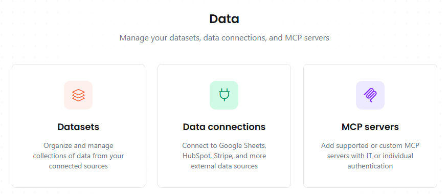

Every app is built on data. **Data** is where you keep it: the datasets apps are built on, the connections that fill them, and the MCP servers that give an app's Assistant tools outside Gainable.

In the builder, open your account menu and select **Data**.

<Frame>
  
</Frame>

| Area | What it holds |
|------|---------------|
| **Datasets** | The data an app is built on: uploaded files, sheets and connected tools, analyzed into tables. One dataset can feed several apps. See [Datasets](/data/datasets). |
| **Data connections** | Your signed-in accounts for Google Sheets, HubSpot, Stripe and other tools. A connection is added to a dataset to bring its data in. See [Data connections](/data/connections). |
| **MCP servers** | Tools outside Gainable, such as Linear, Notion or GitHub, that an app's Assistant can use. See [MCP servers](/data/mcp-servers). |

## From data to app

<Steps>
  <Step title="Connect your sources">
    Upload Excel or CSV files, or add a [data connection](/data/connections) for a tool you use. For a source that has no connector, your AI tool can collect the data for you. See [Bring any source](/data/any-source).
  </Step>
  <Step title="Put them in a dataset">
    Gaia analyzes the sources together into one data model and links records across them. When you build straight from files, it creates the dataset for you. See [Datasets](/data/datasets).
  </Step>
  <Step title="Build from it">
    Select **Add data** under the prompt on [build.gainable.dev](https://build.gainable.dev) and pick your dataset, and Gaia writes the prompt from it. See [Build from data](/build-from-data).
  </Step>
  <Step title="Keep it current">
    Sync the dataset when its sources change. Edits people make in the app are kept. See [Keep data in sync](/data/datasets#keep-data-in-sync) and the app's [Data page](/manage/data).
  </Step>
</Steps>

## Next steps

<CardGroup cols={2}>
  <Card title="Datasets" icon="layer-group" href="/data/datasets">
    Create a dataset and keep it in sync
  </Card>
  <Card title="Data connections" icon="plug" href="/data/connections">
    Connect HubSpot, Stripe, Airtable and more
  </Card>
  <Card title="Bring any source" icon="rotate" href="/data/any-source">
    Let your AI tool collect data from anywhere
  </Card>
  <Card title="MCP servers" icon="screwdriver-wrench" href="/data/mcp-servers">
    Give the Assistant tools outside Gainable
  </Card>
</CardGroup>
