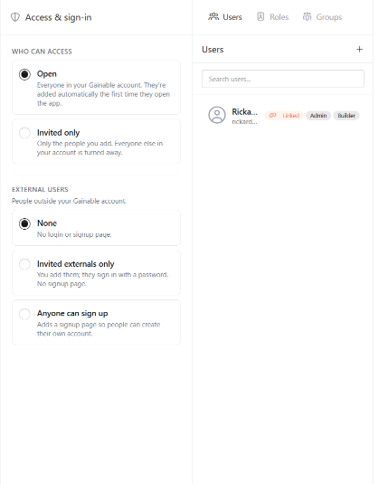
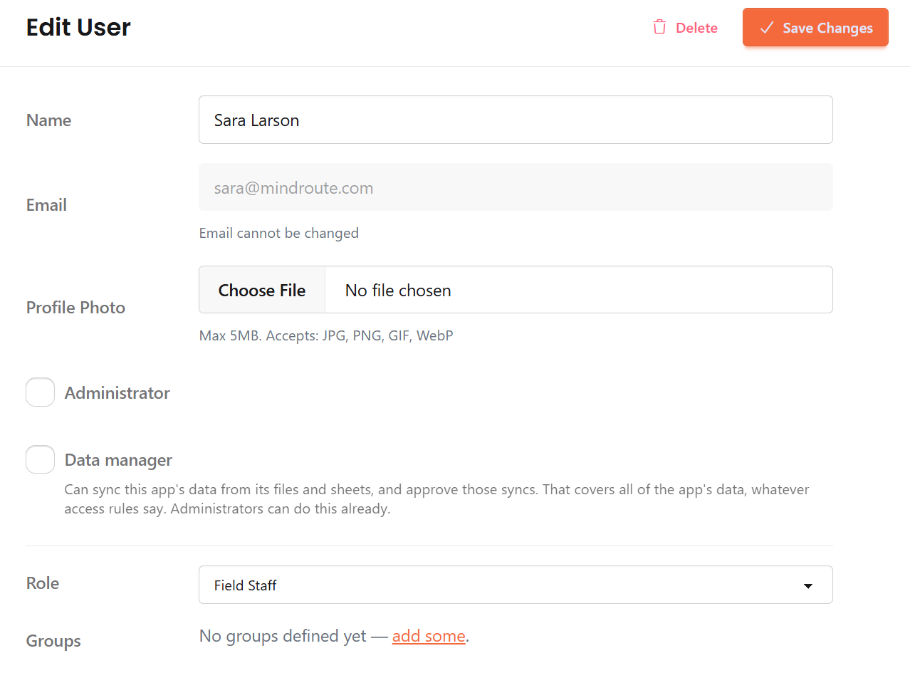
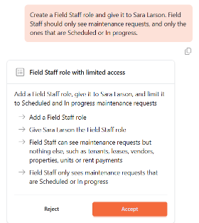

You control two things: **who can get into** the app, and **what each person sees** once they're in. The same rules apply everywhere: on the app's pages, in its live updates, to its Assistant, and to anyone using the app or its Assistant from another AI tool.

## Who can get in

In the builder, open your app and select the people icon in the left rail. The **Access & sign-in** panel sets who can open the app.

<Frame>
  
</Frame>

**Who can access** covers people in your Gainable account:

- **Open**: everyone in your Gainable account. They're added to the app the first time they open it.
- **Invited only**: only the people you add. Everyone else in your account is turned away.

**External users** covers people outside your Gainable account:

- **None**: no sign-in or sign-up page.
- **Invited externals only**: you add them, and they sign in with a password. There's no sign-up page.
- **Anyone can sign up**: adds a sign-up page so people can create their own account. You can limit sign-ups to **Allowed domains** and **Require email verification before login**.

## People in the app

The **Users** tab lists everyone in the app. Select **+** to add someone, or select a person to edit them.

<Frame>
  
</Frame>

Each person can be:

| Setting | What it allows |
|---------|----------------|
| **Builder** | Opens and changes the app in the Gainable builder. Only people in your Gainable account can be builders. |
| **Administrator** | Sees and manages all of the app's scheduled tasks and its Assistant's memory, and can sync the app's data. |
| **Data manager** | Syncs the app's data from its files and sheets and approves those syncs, across all of the app's data, whatever access rules say. Administrators can do this already. See [Keep the app's data current](/manage/data). |
| **Role** | One label that says what the person is, such as Field Staff or Manager. Rules can depend on it. |
| **Groups** | Any number of labels, such as a team. Rules can depend on them too. |

Roles and groups decide what people see. They never decide what people can administer: that's what Administrator and Data manager are for. See [Who does what](/manage/who-does-what) for every kind of user side by side.

Add roles and groups on the **Roles** and **Groups** tabs, or ask for them in the builder chat. Then assign them to people on the **Users** tab.

## What each person sees

Access rules decide which records each person sees. Describe them in plain words in the builder chat:

```text
Owners only see their own deals
```

```text
Create a Field Staff role. Field Staff should only see maintenance requests, and only the ones that are Scheduled or In progress.
```

```text
Only the Finance group can see the salary and bank account columns
```

Gaia shows a plan before it changes anything, so you can check the rule before you accept it.

<Frame>
  
</Frame>

Rules can follow a role, a group, the value of a field, or the person themselves ("their own"). You can add, change and stack them as your team's needs change:

- **One rule per column.** Tightening or changing a rule replaces the old one instead of piling up.
- **"Their own" means the person, not their name.** For rules like "owners only see their own deals" to work, the owner column needs to hold real app users, not names typed as text. Ask Gaia to "make the owners app users" and it matches each name or email to a person, lists any it couldn't match, and keeps the original value visible.
- **Rules work on synced data.** A rule can use a field added in the app on top of data that syncs from a spreadsheet or a connected tool, such as an owner assigned in Gainable. Reassigning a record takes effect immediately.
- **When in doubt, hidden.** If a rule can't be applied, the data stays hidden rather than shown.
- **Drafts until published.** Rules on an unpublished app are marked as drafts. Rolling the app back to an earlier version also sets aside rules created after that point.

## Sensitive columns

Columns with personal data, such as salary or bank account numbers, are imported with a warning and then opened up only to the roles that should see them. Ask for it in the builder chat, as in the Finance example above.
