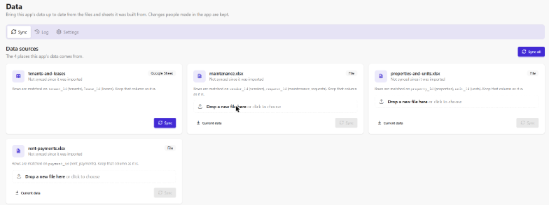
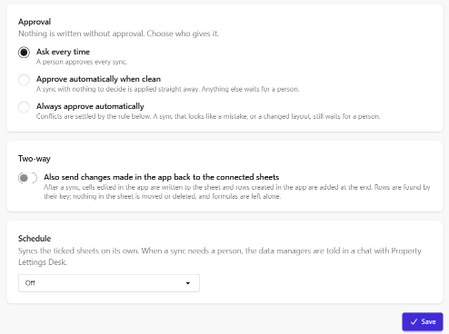

An app built from spreadsheets or connected tools keeps its link to them. The app's **Data** page brings the app up to date from those sources, and changes people made in the app are kept.

Administrators and [Data managers](/manage/access#people-in-the-app) can use the Data page.

## Open the Data page

In the app, select the **Data** icon in the header. The page has three tabs: **Sync**, **Log** and **Settings**.

<Frame>
  
</Frame>

## Sync

Each source the app's data comes from has a card:

- **A connected sheet** (Google Sheets or Excel Online) has a **Sync** button that reads it again.
- **An uploaded file** needs a new version. Drop it on the card, or click to choose it, then select **Sync**. **Current data** downloads the app's current data in the file's own layout, so you can edit it in Excel and upload it again.

**Sync all** syncs every source at once.

Each card says which column rows are matched on, such as `tenant_id`. Keep that column as it is in your file. It's how Gainable knows which row is which, even when other values change.

### What a sync does

- **It merges.** Rows that changed are updated, new rows are added, and edits people made in the app are kept. Unchanged rows aren't touched.
- **It asks before removing.** If a new file doesn't include rows that are in the app, the sync asks whether to keep or remove them. A file that only holds new rows is treated as an addition.
- **It follows renamed tabs and columns.** A renamed tab is followed and reported. If columns were renamed, rows are placed by their key values. If a layout changed in a way it can't settle, the sync says which tab or columns it couldn't find.
- **It reads what's in the file.** Decimal commas, dates in any common order and text numbers are read the same way as when the app was built. See [How Gaia reads your spreadsheets](/build/spreadsheets).
- **It hands off what it can't decide.** Anything unclear goes to a chat with the app's Assistant, with the app's Data managers in it.

## Log

The **Log** tab lists every sync: who ran it, how, and what changed. A sync can be undone from the log. Syncs also appear in the app's [activity log](/manage/activity).

## Settings

<Frame>
  
</Frame>

**Approval.** Nothing is written without approval. Choose who gives it:

- **Ask every time**: a person approves every sync.
- **Approve automatically when clean**: a sync with nothing to decide is applied straight away. Anything else waits for a person.
- **Always approve automatically**: conflicts are settled by rule. A sync that looks like a mistake, or a changed layout, still waits for a person.

**Two-way.** Turn on **Also send changes made in the app back to the connected sheets** to keep a Google Sheet or Excel Online workbook in step with the app. After a sync, cells edited in the app are written to the sheet, and rows created in the app are added at the end. Rows are found by their key. Nothing in the sheet is moved or deleted, and formulas are left alone.

**Schedule.** Sync connected sheets on their own: **Every hour**, **Every day**, **Every weekday**, **Every week** or **Custom**. When a scheduled sync needs a person, the Data managers are told in a chat with the app's Assistant. Uploaded files can't be scheduled, because someone has to supply the new version.

Select **Save** after changing settings.

## Ask the Assistant

Data managers can also ask the app's Assistant to run a sync. A file of only new rows can be talked through with the Assistant before it's applied.
