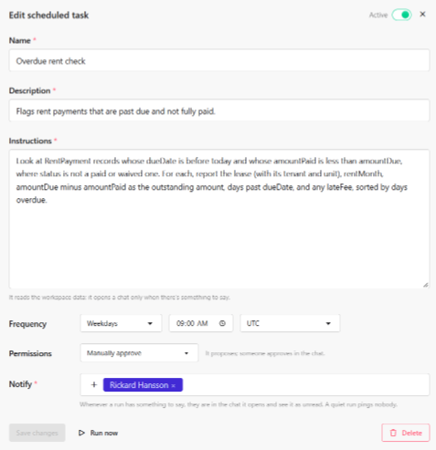
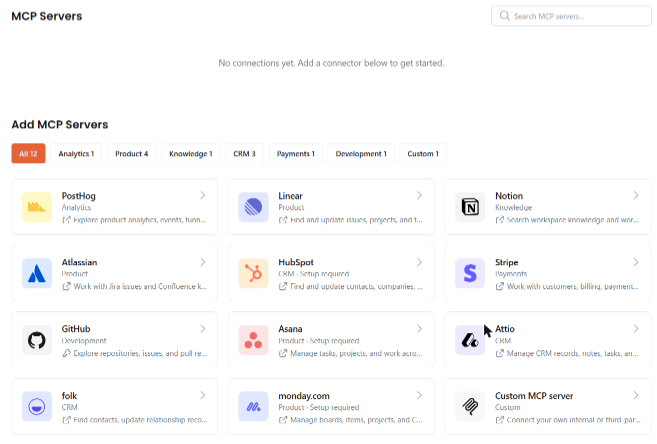

Every app has its own Assistant, an AI teammate that knows the app's data and does work in it. As the app's owner, you decide what it's called, what it knows, what it does on a schedule, and which outside tools it can use. To see how people work with it day to day, see [Work with the Assistant](/use/assistant).

<Note>
Your app's Assistant can have its own name. In the screenshots on this page it's called "Property Lettings Desk". These docs call it the Assistant.
</Note>

## Name, icon and instructions

You change the Assistant's name, icon, instructions and conversation starters by asking for it in the builder chat, the same way you change anything else in the app:

```text
Rename the Assistant to "Lettings Desk" and tell it to always answer in Swedish
```

```text
Change the Assistant's conversation starters to: overdue rent, open maintenance, leases ending this quarter
```

The heading and subheading on the Assistant's new-chat screen can be changed the same way. Rebuilding the app keeps these changes.

## What the Assistant can see

The Assistant works with the same access as the person asking it. If an [access rule](/own/overview#who-can-get-in) hides rows from someone, those rows are hidden from that person's Assistant too. It can't read Gainable's own system data.

## Scheduled tasks

Scheduled tasks are jobs the Assistant runs on its own on a schedule, such as a weekday overdue check or a weekly digest. A new app comes with a few tasks that fit what it's for.

In the app, switch the sidebar to **Assistant** and open **Scheduled** at the bottom of the chat list. Select a task to edit it, or select **+ New schedule**.

<Frame>
  
</Frame>

| Field | What it does |
|-------|--------------|
| **Name** and **Description** | What the task is called and a one-line summary for the people who read its output. |
| **Instructions** | What the Assistant should do on each run, in plain words. It reads the app's data and opens a chat only when there's something to say. |
| **Frequency** | **Hourly**, **Daily**, **Weekdays**, **Weekly** or **Custom…**, plus a time and a time zone. |
| **Permissions** | **Manually approve**: the Assistant proposes changes and someone approves them in the chat. **Run automatically**: it makes them itself. |
| **Notify** | Who is added to the chat a run opens. A quiet run notifies nobody. |

Use **Active** to pause a task without deleting it, and **Run now** to try it once. The **Runs** list on the right shows each past run.

Members see and manage their own scheduled tasks. Administrators see and manage all of them.

## Memory

**Memory** holds knowledge the Assistant reads in every chat: policies, price lists, how your team does things. Open **Memory** at the bottom of the chat list and select **Add files**.

## Outside tools

The Assistant can use tools outside Gainable, such as Linear, Notion, HubSpot, Stripe or your own systems, through MCP servers. Setting one up takes two steps.

<Steps>
  <Step title="Add the server to your account">
    In the builder, open your account menu, select **Data**, then **MCP servers**. Pick a server from the catalog, or **Custom MCP server** to connect your own.

    <Frame>
      
    </Frame>

    For each server, choose who signs in:
    - **IT authenticates**: one sign-in, ready for everyone in the workspace.
    - **Each user authenticates**: every person signs in with their own account.
  </Step>
  <Step title="Give it to the Assistant">
    In the app, open **Connectors** at the bottom of the chat list. Under **Available servers**, add the servers this Assistant can use. All of a server's tools are included.
  </Step>
</Steps>

## Share the Assistant outside Gainable

The **Share** tab in the same **Connectors** dialog lets people reach the Assistant from ChatGPT, Claude or another AI tool. See [Share the Assistant](/own/share-assistant).
