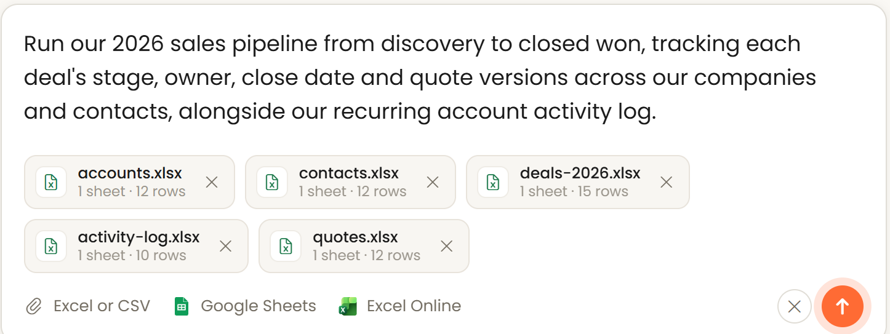
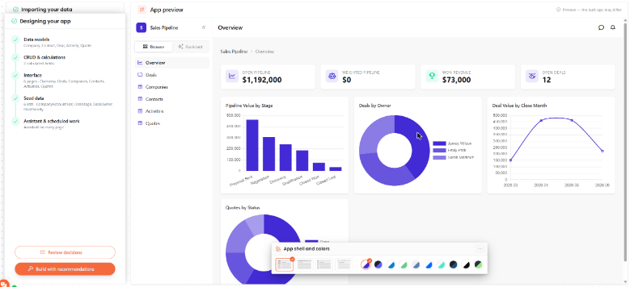
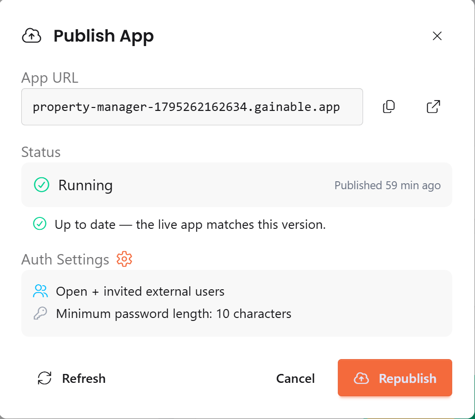

This quickstart builds a sales pipeline app from five spreadsheets. You'll watch Gaia design the app, review what it decided, build it, and make your first change.

## 1. Drop in your sheets

Go to [gainable.dev](https://www.gainable.dev) and drop your spreadsheets into the box, or choose **Excel or CSV**, **Google Sheets** or **Excel Online**. You can add as many sheets as belong together, and Gaia works out how they connect.

No sheets at hand? Pick a sample under **Try a sample**. This quickstart uses **Deals Pipeline**, which has five sheets: accounts, contacts, deals, activities and quotes.

<Frame>
  
</Frame>

Gaia writes a one-line description of the work the sheets support. Edit it if it's not quite right, because it steers what gets built. Then select **Build this**.

<Tip>
Already signed in? You can also start from [build.gainable.dev](https://build.gainable.dev): choose **Build from data** to use a dataset you have, or **Describe your app** to start from an idea instead of data.
</Tip>

## 2. Watch Gaia design the app

Gaia reads your sheets, designs a data model, imports your rows, and then designs the app: its data models, calculations, pages, lists and the Assistant. The preview fills in as it goes, first with placeholders and then with your real data.

<Frame>
  
</Frame>

While it works, pick the app's layout and colors from **App shell and colors** under the preview.

## 3. Review Gaia's decisions

When the design is done, you can build straight away with **Build with recommendations**, or select **Review decisions** first to check the choices Gaia made for you, such as which page opens first, whether the people in your sheets get to sign in, and which recurring jobs the Assistant should run. See [Review decisions](/build-from-data#review-decisions).

## 4. Build the app

Select **Build the app**. If you aren't signed in yet, this is when you create your account, with email or Google. Your design is kept.

The build takes a few minutes. When it's done, select **Go to app**.

## 5. Make your first change

The builder opens with your app on the right and a chat on the left. Describe a change in plain words:

```text
Add a "Next step" text field to deals and show it on the deal cards
```

Gaia shows a plan of what it will change. Accept it, and the preview updates when the change is built. See [Changing a built app](/prompting/refining).

## 6. Publish and invite your team

Select **Publish**, then **Publish** in the dialog, to make the app live. The dialog shows the app's address and whether the live app matches the latest version. After later changes, the button shows a dot until you **Republish**.

<Frame>
  
</Frame>

Then open the people icon in the builder's left rail to decide who can get in. See [Manage an app](/manage/overview).

Everyone you invite finds the app on their [Apps grid](/use/apps-grid), and its [Assistant](/use/assistant) is ready to answer questions about your data.

## What's next?

<CardGroup cols={2}>
  <Card title="Build from data" icon="database" href="/build-from-data">
    Everything about turning your data into an app
  </Card>
  <Card title="Datasets" icon="layer-group" href="/build/datasets">
    Connect sources and keep your data in sync
  </Card>
  <Card title="Changing a built app" icon="pen" href="/prompting/refining">
    Ask for changes once your app is running
  </Card>
  <Card title="Set up the Assistant" icon="sliders" href="/manage/assistant">
    Shape your app's Assistant and its scheduled tasks
  </Card>
</CardGroup>
