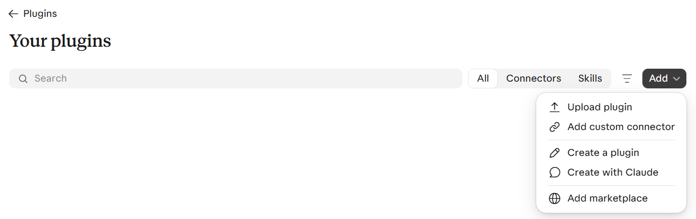
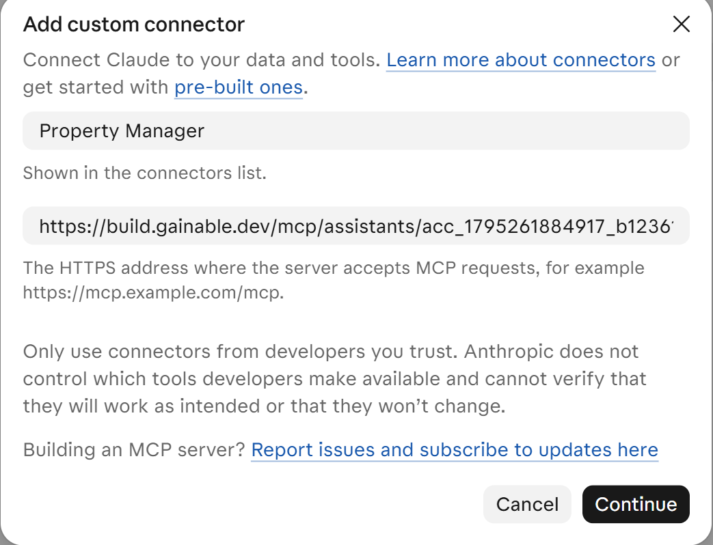
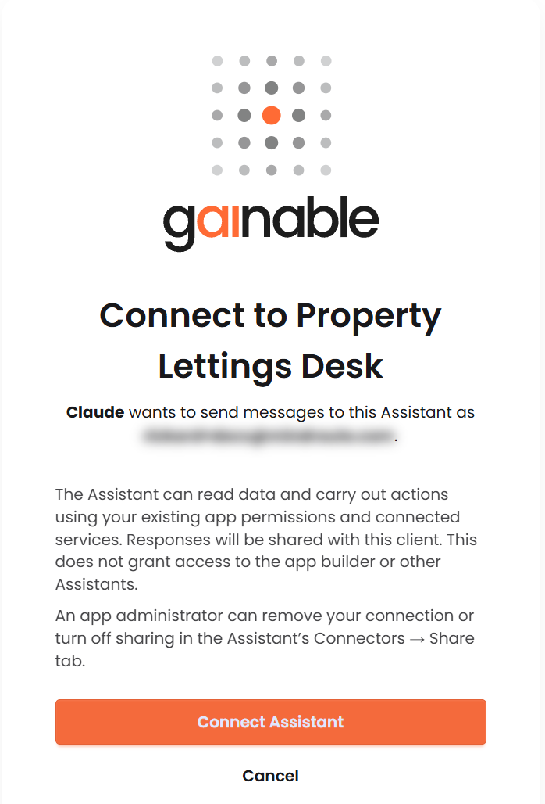
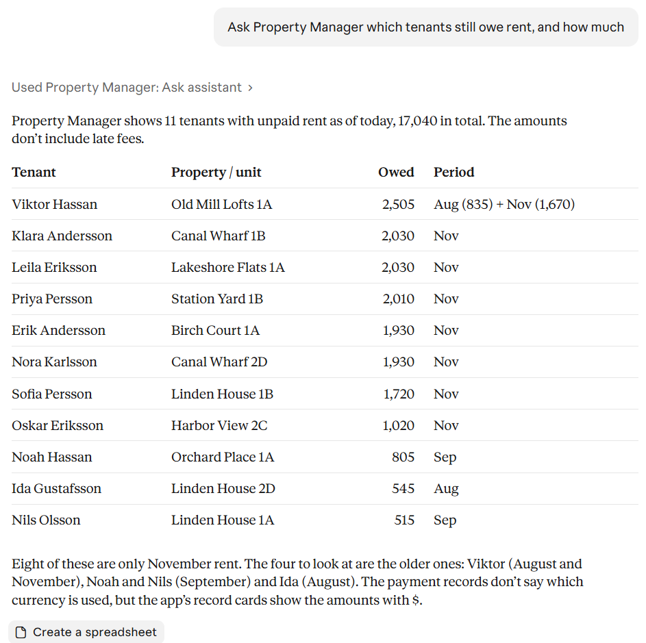
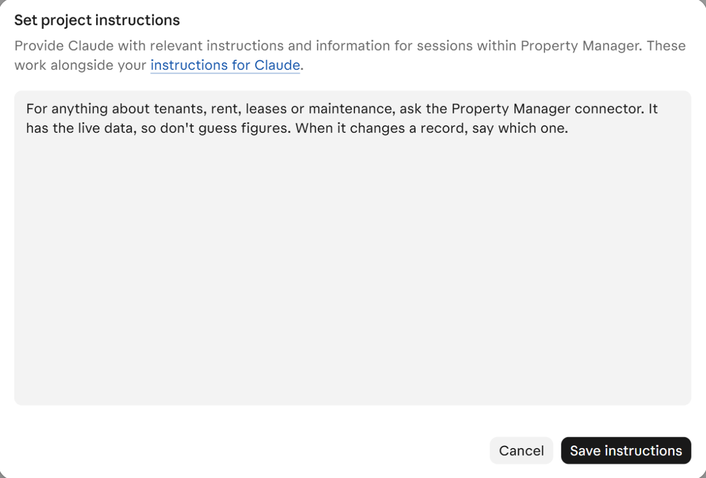
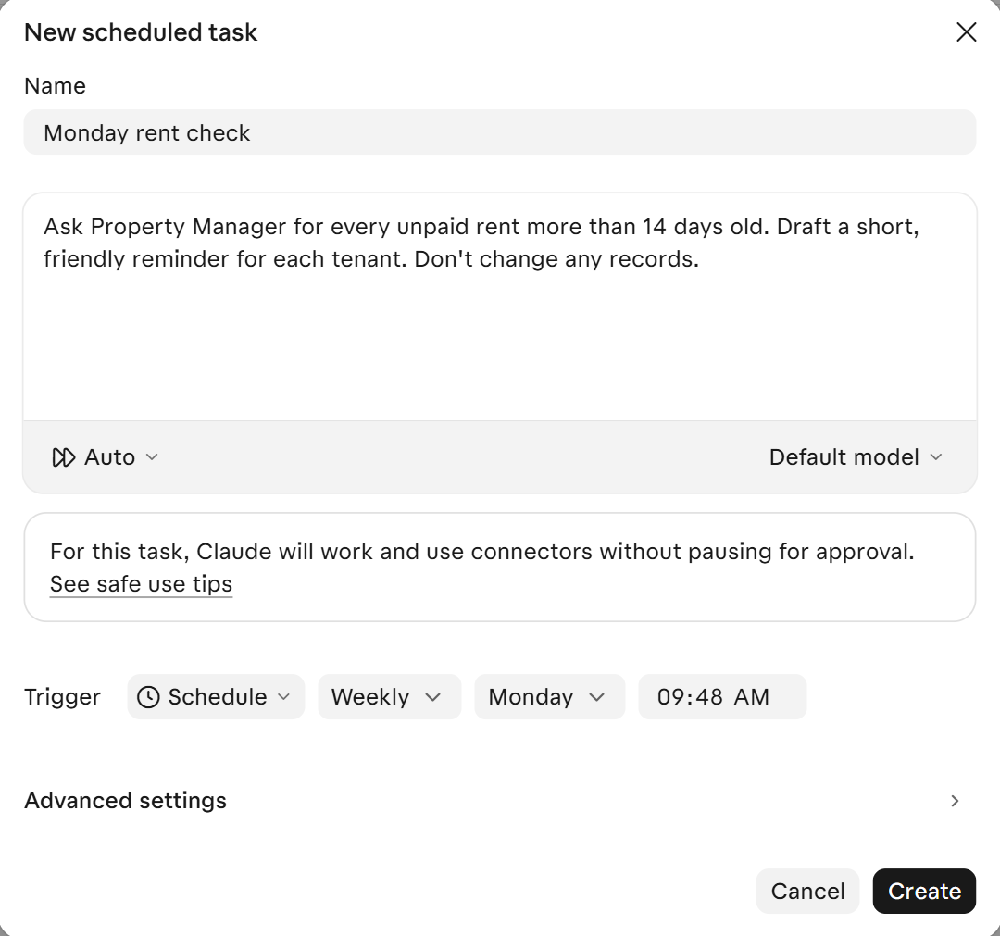

Every app's Assistant can be added to the AI tool you already work in. Once it's connected, you can ask about the app's data, update records and hand it recurring work from a Claude project or a ChatGPT chat, without opening the app.

You're talking to the same Assistant as in the app. It reads the app's live data, follows the same access rules, and only sees and changes what you're allowed to see and change.

<Note>
This page connects you to one app's **Assistant**, to work with that app's data. To build and change apps from your AI tool, connect to **Gaia** instead. See [the Gaia connector](/mcp/overview).
</Note>

## Get the link

Each app's Assistant has its own link. The app's owner has to [turn on sharing](/manage/share-assistant) before there is one.

<Steps>
  <Step title="Open Connectors">
    In the app, switch the sidebar to **Assistant** and select **Connectors** at the bottom of the chat list.
  </Step>
  <Step title="Copy the link">
    Select **Copy link to Assistant**. If you manage the app, the button is on the **Share** tab.
  </Step>
</Steps>

If there's no **Copy link to Assistant** button, sharing is off for that app. Ask the app's owner to turn it on.

## Add it to Claude

<Steps>
  <Step title="Add a custom connector">
    In Claude, open **Plugins**, select **Add**, then **Add custom connector**. In some versions of Claude it's under **Settings → Connectors**.

    <Frame>
      
    </Frame>
  </Step>
  <Step title="Name it and paste the link">
    Give it the app's name, so you can tell your apps apart, and paste the link into the server URL field. Select **Continue**, leave the sign-in options Claude detects as they are, and select **Add**.

    <Frame>
      
    </Frame>
  </Step>
  <Step title="Sign in">
    Sign in with your Gainable account. Gainable shows what you're connecting: the Assistant can read data and do work with your permissions in the app, and nothing else. Select **Connect Assistant**.

    <Frame>
      
    </Frame>
  </Step>
</Steps>

Then ask Claude, naming the connector:

```text
Ask Property Manager which tenants still owe rent, and how much
```

Claude passes the question to the Assistant and answers from the app's live data. The first answer can take up to a minute.

<Frame>
  
</Frame>

## Add it to ChatGPT

Add the link as a custom connector, where your ChatGPT plan lets you add one, and sign in with your Gainable account when ChatGPT asks. In a chat, pick the connector and ask your question.

## Other AI tools

Any tool that supports remote MCP servers with OAuth sign-in works the same way: add the link as a server and sign in with your Gainable account.

## Make it part of your work

Connected once, the Assistant is there whenever you need the app's data. A few ways to put it to work:

<AccordionGroup>
  <Accordion title="Give a Claude project the app">
    Put the work around an app in its own project, and tell Claude in the project's **Instructions** when to use it:

    <Frame>
      
    </Frame>

    Every chat in the project then starts from the app's real data.
  </Accordion>
  <Accordion title="Schedule recurring work">
    A Claude project can run tasks on a schedule: select **Add** next to **Scheduled**. For example, a weekly rent check:

    <Frame>
      
    </Frame>

    Scheduled tasks run as you, with your access in the app, and Claude uses connectors in them without pausing for your approval. Say in the task whether it may change records.
  </Accordion>
  <Accordion title="Combine it with your other tools">
    The Assistant works alongside the AI tool's other connectors. Have Claude read an email and log it in the app:

    ```text
    Read the latest email from Comfort Heating and add it as a comment
    on the matching maintenance request in Property Manager
    ```
  </Accordion>
  <Accordion title="Work across several apps">
    Add each app's Assistant as its own connector, named after the app. Your AI tool can then ask more than one in the same chat, for example to compare figures between two apps.
  </Accordion>
</AccordionGroup>

## How it works

- **It acts as you.** The Assistant uses your access in the app. If you can't see a record in the app, you can't get it from your AI tool either.
- **It can change data.** Ask it to update or add records and it does, the same as in the app. Your AI tool may ask you to approve those requests.
- **Your conversations are in the app.** Each conversation also shows up in the app's chat list, visible only to you.
- **Longer requests take a moment.** If a request takes more than about a minute, your AI tool checks back for the answer instead of sending the request again.
- **One link, one app.** The link reaches only this app's Assistant. It doesn't give access to other apps, to building apps, or to the rest of your Gainable account.

## If it stops working

Your connection ends when the app's owner turns sharing off or removes your connection, or when you lose access to the app. Your AI tool then asks you to sign in again, or reports that the Assistant connection is expired or revoked. Once you have access again, reconnect the connector and sign in.
