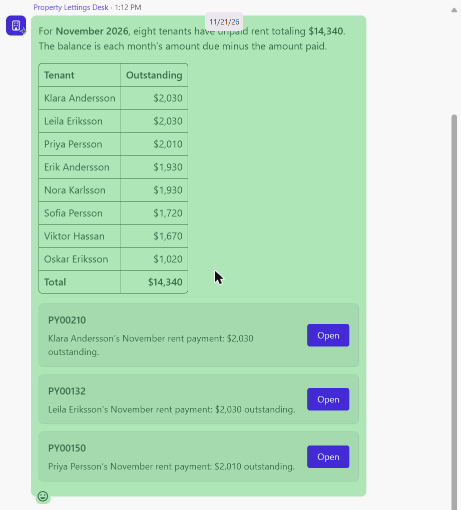
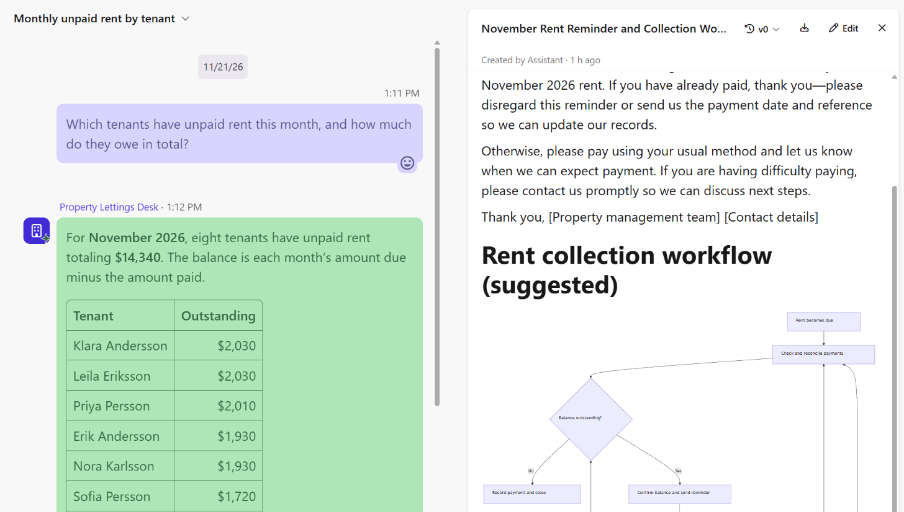
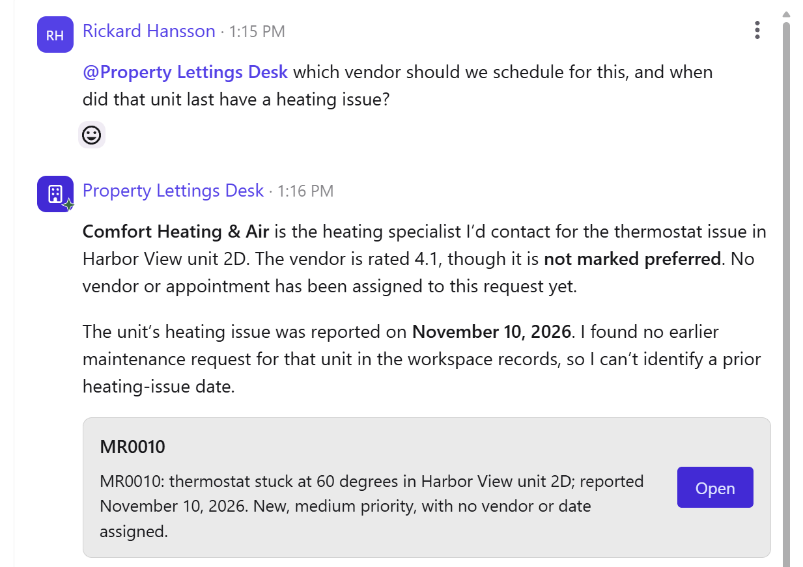

Every app has its own Assistant: an AI teammate that knows the app's data and can do work in it. Ask it what's going on, have it update records, get it to write a document, or mention it on a record to get help right there.

The Assistant only sees and changes what you're allowed to see and change in the app.

<Note>
Your app's Assistant may have its own name, such as "Property Lettings Desk" in the examples below. These docs call it the Assistant.
</Note>

## Start a chat

In the app, switch the sidebar from **Browse** to **Assistant**. Type what you need, or pick one of the suggested starters under the message box.

The Assistant reads the app's live records before it answers. When an answer is about specific records, it adds a card for each one. Select **Open** to go straight to that record.

<Frame>
  
</Frame>

You can also ask it to do things:

```text
Mark Klara Andersson's November payment as paid
```

```text
Add a maintenance request for unit UN041: radiator not heating, high priority
```

```text
Assign Comfort Heating & Air to every new heating request
```

It makes the change and tells you what it changed.

Your chats are listed in the sidebar, each named after what it's about, so you can come back to them. Select **+ New** to start another.

## Documents and diagrams

Ask for a letter, a summary, a report or a plan, and the Assistant writes it as a document in the chat. When a process or a breakdown is quicker to show than to explain, it draws a diagram.

<Frame>
  
</Frame>

Documents open in a panel next to the chat. From there you can **Edit** the document yourself, download it, or open an earlier version from the version menu. The chat's documents are also listed under **Artifacts** on the right.

## Bring colleagues in

Chats can be shared. Select **Invite** in the **People** panel on the right and pick a colleague from the app. They join the chat, see everything in it, and can talk to the Assistant too.

## Mention the Assistant on a record

You don't have to leave a record to get help with it. Open the record, go to **Comments**, type **@** and pick the Assistant. It answers in the comment thread, using that record and anything related to it.

<Frame>
  
</Frame>

## From your own AI tool

If the app's owner has [shared the Assistant](/manage/share-assistant), you can use it from ChatGPT, Claude or any other AI tool that supports MCP connectors:

1. Get the link to the Assistant from the app's owner.
2. Add it to your AI tool as a connector. In Claude, that's a custom connector. See [Claude and Cowork](/mcp/claude) for where to add one.
3. Sign in with your Gainable account when your AI tool asks.

Then ask your questions in that tool. The Assistant answers from the app's live data, with the same access you have in the app, and your conversations also show up privately in the app.
