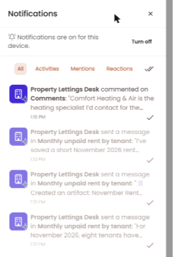
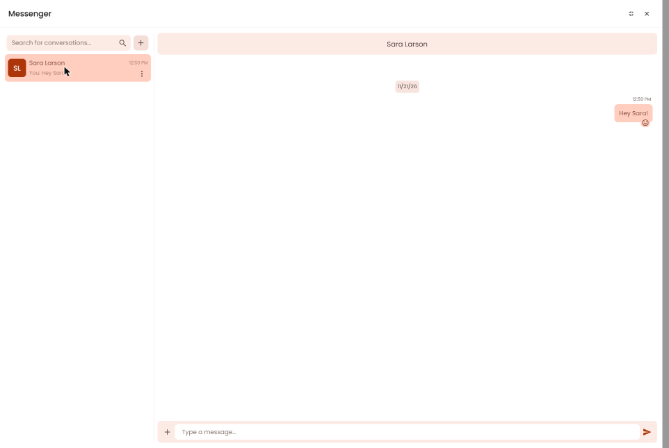

Notifications from every app you use land in one place, and you can message anyone in your Gainable account without leaving the app you're in. Both are in the header of the Apps grid and of every app.

## Notifications

Select the bell. Notifications from all of your apps are listed together: someone mentioned you or reacted, the Assistant answered in a chat or a comment thread you're in, or a scheduled task has something to say.

<Frame>
  
</Frame>

- Filter by **All**, **Activities**, **Mentions** or **Reactions**.
- Select a notification to go straight to it. A notification about a record opens that record, on the right tab, for example **Comments**.
- Use the check mark on a notification to mark it as read, or the double check mark at the top to mark them all as read.

### On this device

At the top of the panel, select **Turn on** to get notifications on this device even when Gainable isn't open. **Turn off** stops them. If your browser blocks notifications for the site, allow them in the browser's settings. On a phone, see [Gainable on your phone](/use/mobile).

## Messenger

Select the chat icon to open the **Messenger**: direct and group conversations with the people in your Gainable account.

<Frame>
  
</Frame>

- Select **+** to start a conversation with one or more people.
- Search your conversations with **Search for conversations…**.
- Attach files with **+** next to the message box.

## Team updates

The **Feed** widget on the [Apps grid](/use/apps-grid), and the **Team Updates** panel in many apps, are for posts the whole team should see. Comment on a post to discuss it.
